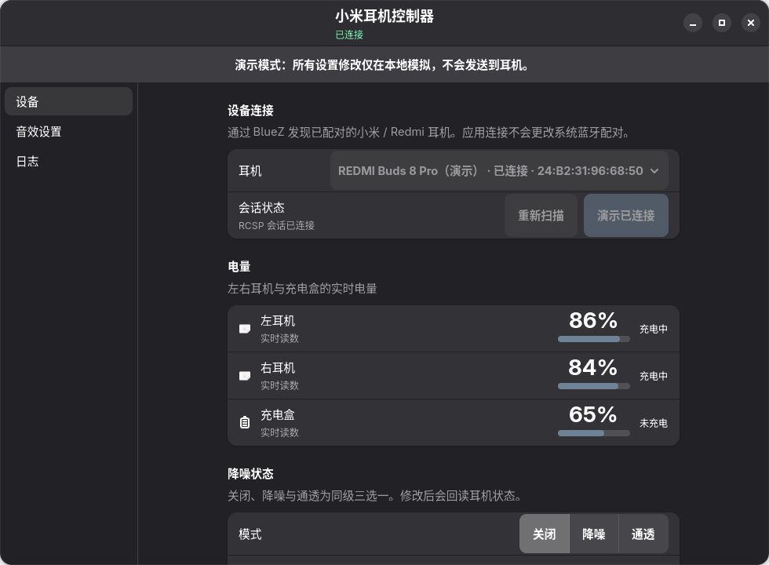
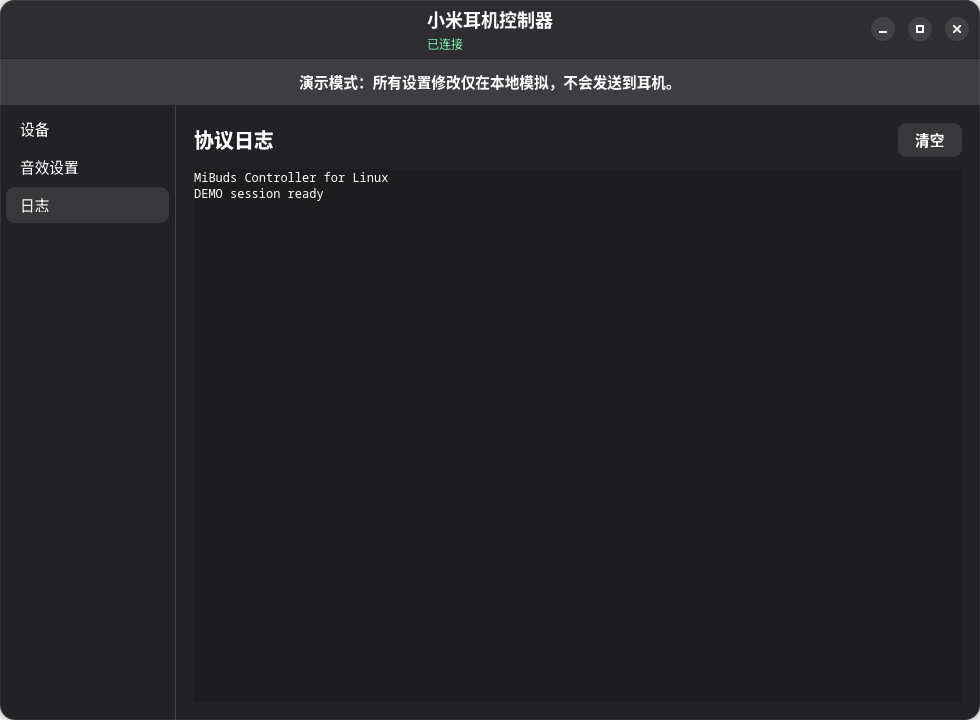
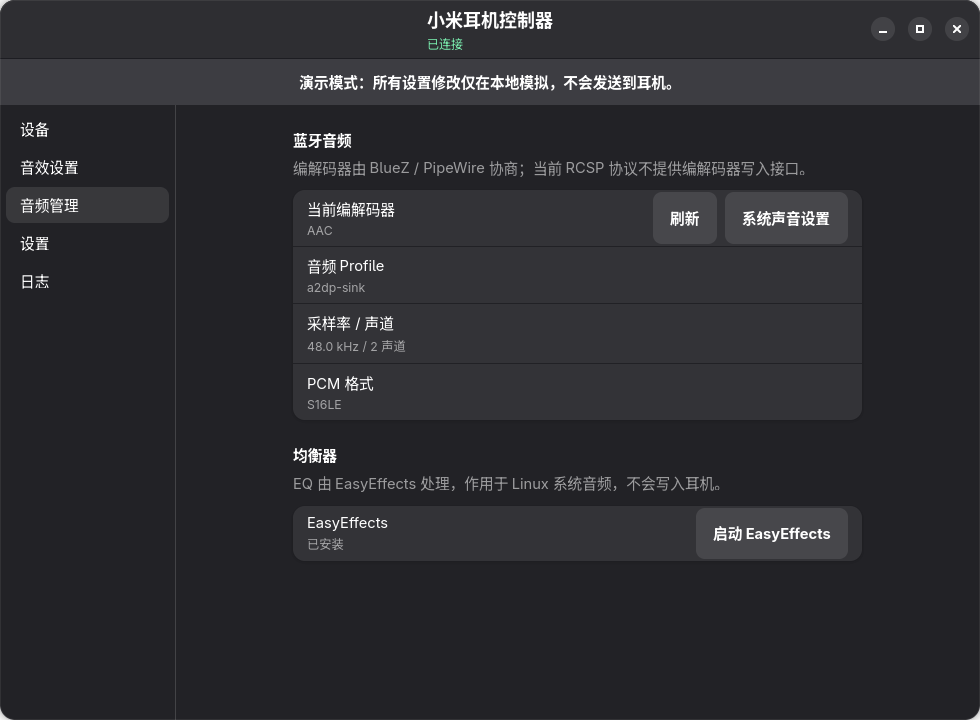
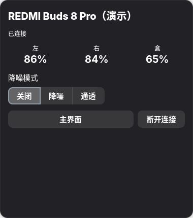

# MiBudsController Linux
*由AI制作 Created by AI

> 非官方 Linux 小米 / Redmi 耳机控制工具，基于 BlueZ 与 RCSP 协议，通过蓝牙 Classic RFCOMM 控制 Redmi Buds 8 Pro。

MiBudsController Linux 是一个使用 Python、GTK 4 和 libadwaita 开发的 Linux 桌面应用。项目参考了 [FallenLeeee/MiBudsController](https://github.com/FallenLeeee/MiBudsController) 的 Windows 实现，将设备发现、RFCOMM 通信、SAFER+ 鉴权和 RCSP 协议迁移到 Linux。

当前版本：**0.2.0**

## 功能

- [x] 通过 BlueZ 发现已配对的小米 / Redmi 耳机
- [x] 自动查询厂商控制服务的 RFCOMM 通道
- [x] RFCOMM 连接与 SAFER+ 鉴权
- [x] 左右耳机与充电盒电量显示
- [x] 固件版本、VID/PID 和连接通道显示
- [x] 降噪模式切换：关闭、降噪、通透
- [x] 低延迟模式开关
- [x] 设置后自动回读设备状态
- [x] 自动重连与连接失败指数退避重试
- [x] 系统托盘、迷你面板、最小化到托盘
- [x] 用户级开机自启
- [x] PipeWire 蓝牙编解码器、采样率和音频 Profile 显示
- [x] EasyEffects 安装、启动入口与 Linux 系统 EQ
- [x] RCSP 原始帧与协议日志


## 界面截图

### 设备页面



### 音效设置


### 协议日志



### 音频管理



### 迷你面板



## 支持范围

### 已验证设备

- **Redmi Buds 8 Pro**
- 测试固件版本：`1.3.8.3`
- 测试环境：Fedora Linux 45、BlueZ、Bluetooth Classic

其他小米 / Redmi 耳机可能支持部分功能，但协议、固件和功能映射可能不同，不保证兼容。

### 系统要求

- Linux 桌面环境
- BlueZ 蓝牙服务
- 支持 Bluetooth Classic RFCOMM 的蓝牙适配器
- 耳机已由系统蓝牙完成配对
- x86_64 架构安装包

> 仅支持 BLE 的适配器无法使用本项目。耳机的厂商控制服务不会通过普通 BLE GATT 暴露。

## 工作原理

应用按照以下流程与耳机通信：

1. 通过 BlueZ D-Bus 获取已配对设备及其连接状态。
2. 使用 `libbluetooth` 查询控制服务 `0000fd2d-0000-1000-8000-00805f9b34fb` 的 SDP 记录。
3. 从协议描述符中取得 RFCOMM 通道并建立 Socket 连接。
4. 完成 SAFER+ 挑战应答与鉴权确认。
5. 使用 RCSP 帧读取设备信息、运行信息和配置项。
6. 根据需要发送降噪或低延迟控制指令，并回读确认状态。

RFCOMM 通道由设备动态决定，不硬编码。Redmi Buds 8 Pro 在测试设备上使用通道 `28`，其他设备或固件可能不同。

## 安装

### AppImage

```bash
chmod +x MiBudsController-0.2.0-x86_64.AppImage
./MiBudsController-0.2.0-x86_64.AppImage
```

AppImage 已包含 Python、GTK 4、libadwaita 和蓝牙相关运行库，但仍需要宿主系统提供兼容的 glibc、D-Bus 和 BlueZ。当前 AppImage 在 Fedora 45 上构建；较旧的系统可能因 glibc 版本不足而无法运行。

### Fedora / RHEL 系 RPM

先导入签名公钥：

```bash
sudo rpmkeys --import ./mibuds-controller-signing-key.asc
```

再安装 RPM：

```bash
sudo dnf install ./mibuds-controller-0.2.0-1.fc45.noarch.rpm
```

签名公钥指纹：

```text
EAC41C9F4C8C63F97F98710A7CCBE5B4D4FED2BE
```

### Debian / Ubuntu 系 DEB

```bash
sudo apt install ./mibuds-controller_0.2.0-1_amd64.deb
```

DEB 包会通过包管理器安装 Python、GTK 4、libadwaita、D-Bus 和 BlueZ 依赖。

### 从源码运行

Fedora：

```bash
sudo dnf install python3 python3-gobject gtk4 libadwaita python3-dbus bluez bluez-libs
./mibuds-gui
```

Debian / Ubuntu：

```bash
sudo apt install python3 python3-gi gir1.2-gtk-4.0 gir1.2-adw-1 python3-dbus bluez libbluetooth3
./mibuds-gui
```

不同发行版的软件包名称和版本可能略有差异。

## 使用说明

### 图形界面

1. 在系统蓝牙设置中配对并连接 Redmi Buds 8 Pro。
2. 启动 `mibuds-gui`。
3. 在“设备连接”中选择耳机。
4. 点击“连接”，等待鉴权和状态同步完成。
5. 在设备页面查看电量、固件和降噪状态。
6. 在“音效设置”中切换低延迟模式。
7. 在“音频管理”中查看当前编解码器、采样率和音频 Profile，并启动 EasyEffects 调整 Linux 系统 EQ。
8. 在“设置”中管理自动重连、启动时连接、最小化到托盘和开机自启。
9. 如需排查问题，打开“日志”页面查看 RCSP 收发帧。

“断开连接”只会关闭应用持有的 RCSP 会话，**不会断开系统蓝牙音频连接**。会话意外中断后，应用默认按指数退避自动重试；点击“停止重试”或关闭“自动重连”即可停止。

系统托盘提供“打开主界面”“迷你面板”“重新连接”“断开连接”和“退出”。迷你面板支持电量查看与降噪切换。开机自启写入当前用户的 `~/.config/autostart`，不需要 sudo。

EQ 由 EasyEffects 处理，作用于 Linux 系统音频，不会写入耳机。未安装 EasyEffects 时，音频页可通过 Flatpak 发起用户级安装。

### 演示模式

演示模式使用本地模拟会话，不会连接或修改真实耳机：

```bash
./mibuds-gui --demo
```

### 命令行协议探针

命令行工具默认只读，不提供设置写入命令。

列出 BlueZ 已配对设备：

```bash
./mibuds-probe list
```

查询指定耳机的 RFCOMM 通道：

```bash
./mibuds-probe inspect --address 24:B2:31:96:68:50 --json
```

执行完整只读验证：

```bash
./mibuds-probe --verbose probe \
  --address 24:B2:31:96:68:50 \
  --no-connect \
  --timeout 8 \
  --json
```

如果 SDP 查询失败但已经知道通道，可以手动指定：

```bash
./mibuds-probe --verbose probe \
  --address 24:B2:31:96:68:50 \
  --channel 28 \
  --no-connect \
  --json
```

`--no-connect` 表示只使用系统当前已连接的状态，不主动调用 BlueZ 的设备连接流程。

## 项目结构

```text
.
├── mibuds-gui                 # GTK 图形界面入口
├── mibuds-probe               # 只读协议探针入口
├── mibuds_probe/
│   ├── audio.py                # PipeWire 编解码器与 EasyEffects 集成
│   ├── bluez.py                # BlueZ D-Bus、SDP 与 RFCOMM 传输
│   ├── client.py               # RCSP 会话、鉴权、状态读写
│   ├── cli.py                  # 命令行界面
│   ├── gui.py                  # GTK 4 / libadwaita 图形界面
│   ├── protocol.py             # RCSP 帧、SAFER+、TLV 与配置常量
│   ├── settings.py             # 用户设置与开机自启
│   ├── tray.py                 # StatusNotifierItem 托盘与 DBusMenu
│   └── __init__.py             # 版本信息
├── packaging/                 # 桌面入口、图标与 RPM spec
├── tests/                     # 协议、会话与 GUI 自动化测试
├── docs/screenshots/          # README 截图
└── LICENSE                    # MIT 许可证
```

## 开发与测试

运行全部测试：

```bash
python3 -m unittest discover -s tests -v
```

测试包含：

- RCSP 帧编码、解码与粘包/半包处理
- SAFER+ 固定向量与鉴权流程
- 请求超时与响应匹配
- 降噪和低延迟指令编码
- GUI 演示模式、控件状态、页面导航、托盘和迷你面板
- 自动重连调度与断线回调
- PipeWire 编解码器解析、用户设置和开机自启

GUI 测试需要可用的图形显示环境；在没有 `DISPLAY` 或 `WAYLAND_DISPLAY` 的环境中会自动跳过。

## 尚未实现

- 智能降噪、降噪强度与通透预设控制
- 空间音频、沉浸声、小米/杜比模式、场景渲染和头部追踪
- 自适应听感、EQ 协议写入和音频编解码器写入
- 多耳机同时管理与快速切换
- ARM64 安装包
- 其他小米 / Redmi 型号的完整适配

空间音频还涉及 Linux 音频渲染栈，即使协议控制可用，也不代表 PipeWire 下能够完整实现厂商空间音频或头部追踪。

## 故障排除

### 找不到耳机

- 确认耳机已在系统蓝牙中配对。
- 确认设备名称包含 `Redmi`、`Xiaomi` 或 `Buds`。
- 使用 `./mibuds-probe list` 检查 BlueZ 是否能发现设备。
- 使用 `--address` 指定蓝牙 MAC 地址。

### 连接超时

- 确认耳机已开机，必要时打开充电盒。
- 先在系统蓝牙中手动连接一次。
- 断开耳机与其他手机或电脑的连接。
- 使用 `bluetoothctl info <MAC>` 检查 `Connected` 状态。

### SDP 查询失败或 Host is down

- SDP 查询通常需要耳机已经可连接。
- 先完成系统蓝牙连接，再运行 `inspect` 或 `probe`。
- 检查 BlueZ 服务：

```bash
systemctl status bluetooth
```

### 找不到 fd2d 服务

- 当前型号可能不支持该厂商控制协议。
- 固件或区域版本可能未暴露控制服务。
- 查看 `./mibuds-probe list --json` 中的 `has_control_service`。

### SAFER+ 鉴权失败

- 使用 `--verbose` 保存并检查 TX/RX 帧。
- 确认没有其他应用同时占用厂商控制通道。
- 不同固件可能使用不同的鉴权变体，需要进一步适配。

### 设置后状态没有变化

- 等待自动回读完成。
- 查看日志中是否出现 opcode `0x00` 的异常 ACK。
- 部分能力受固件、区域和耳机当前状态限制。

## 安全与隐私

- 项目为非官方实现，与小米 / Redmi 无隶属关系。
- 只向用户选择的已配对耳机发送 RCSP 指令。
- 命令行探针仅执行读取，不修改耳机设置。
- 图形界面当前仅提供降噪模式和低延迟两类写入控制。
- 默认不包含遥测、云服务或远程上传功能。
- 协议日志仅显示在当前进程内，不自动写入持久化文件。

使用前请备份重要耳机设置，并自行承担使用风险。

## 许可证

本项目采用 [MIT License](LICENSE)。

项目参考了 FallenLeeee/MiBudsController 的协议实现，SAFER+ 实现来源于 Gadgetbridge 相关认证代码的移植。

## 致谢

- [FallenLeeee/MiBudsController](https://github.com/FallenLeeee/MiBudsController)
- [Gadgetbridge](https://github.com/Freeyourgadget/Gadgetbridge)
- [BlueZ](https://github.com/bluez/bluez)
- GTK 4 与 libadwaita 社区
